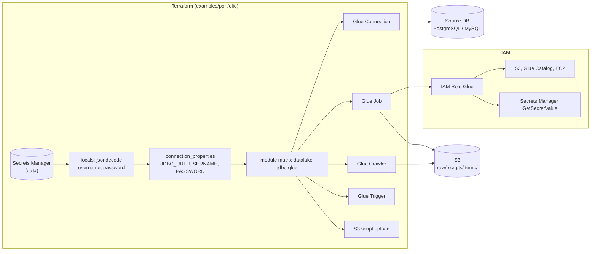

# Matrix Datalake JDBC Glue (Terraform)

A small, production-minded Terraform module to deploy **AWS Glue JDBC ingestion building blocks**:

- S3 script upload (optional)
- Glue Connection (JDBC)
- Glue Job (Glue ETL)
- Glue Crawler (optional)
- Glue Trigger (optional)

This repo is **safe to share publicly**: examples use **fictitious** JDBC endpoints and credentials.

## Why this exists

When building a data lake, teams repeatedly wire the same pieces (Connection + Job + optional Crawler/Trigger).  
This module packages that pattern as a clean, reusable interface.

## Module

Path: `modules/matrix-datalake-jdbc-glue`

### Inputs (high level)

- `scripts_bucket`, `scripts_prefix`, `script_local_path`
- `connection_properties` (JDBC URL, username, password)
- `iam_role_arn` (Glue role)
- Optional crawler/trigger toggles

## Example

- **`examples/portfolio`** — Ejemplo reproducible: Secrets Manager → connection_properties, dos jobs (PostgreSQL y MySQL), scripts en `scripts/`. Config en `terraform.tfvars` y `backend.hcl`.  
  Ver [examples/portfolio/README.md](examples/portfolio/README.md).

## Arquitectura IaC

Flujo Terraform → Glue (ejemplo portfolio):

| Componente | Origen | Función |
|------------|--------|---------|
| **Secrets Manager** | Existente en AWS | Secret JSON `username`/`password`; Terraform lo lee con `data "aws_secretsmanager_secret_version"`. |
| **locals** | `locals.tf` | `jdbc_credentials = jsondecode(secret_string)`; construye `connection_props_*` con USERNAME/PASSWORD. |
| **module matrix-datalake-jdbc-glue** | `modules/` | Crea Glue Connection, Job, Crawler opcional, Trigger opcional; sube script a S3. |
| **IAM Role** | `main.tf` | Rol para Glue con permisos S3, Glue Catalog, EC2/VPC y Secrets Manager. |

## Notes

- JDBC drivers may be needed (e.g., MySQL/SQL Server). Add them via `--extra-jars` or a Glue job parameter / library.
- For real deployments, store credentials in AWS Secrets Manager and inject them into `connection_properties` via data sources.

